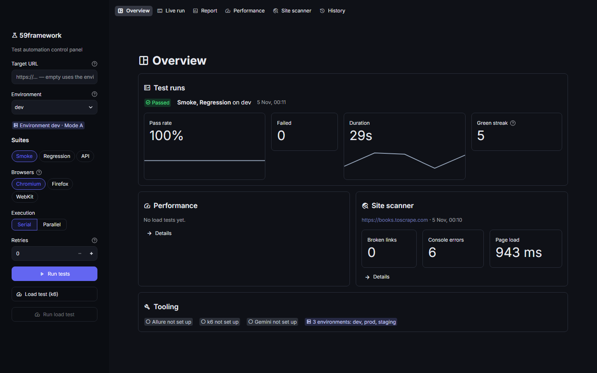
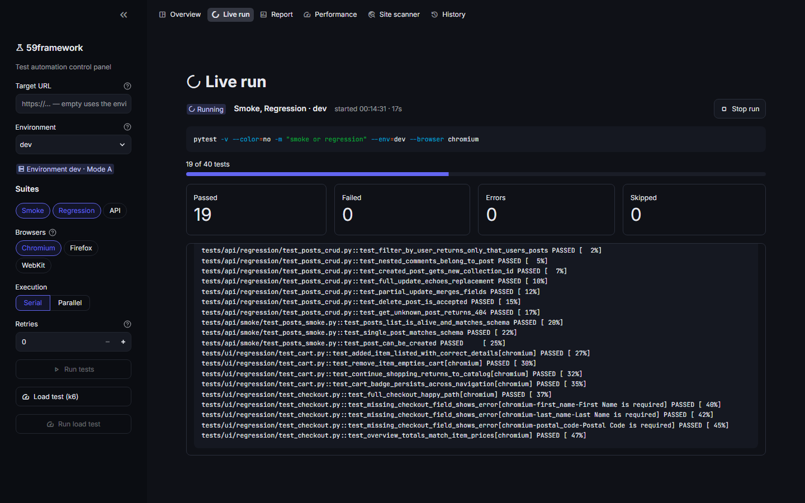
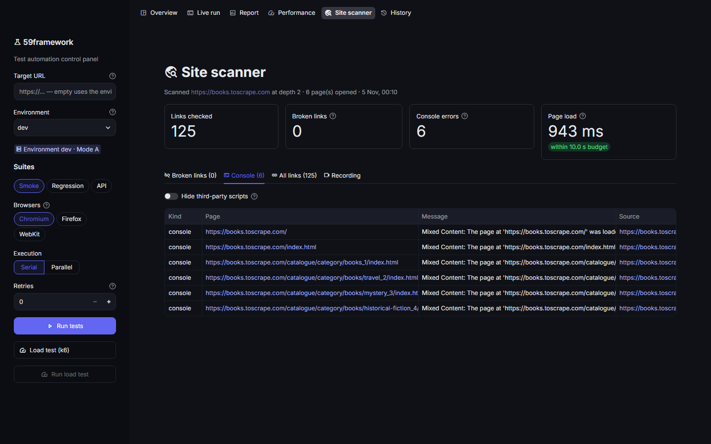
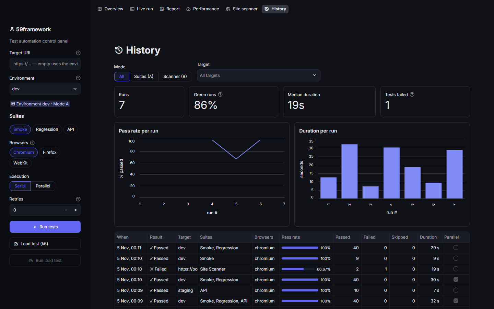
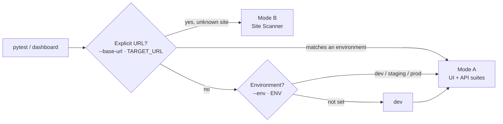
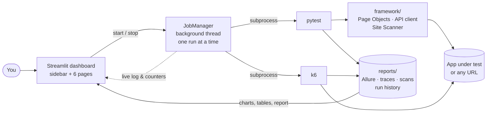

<div align="center">

# 🧪 59framework

**Test automation framework and control panel in one repo.**<br>
Playwright + pytest for UI and API suites, a Site Scanner that audits *any* URL,
k6 load tests, Allure reports — all driven from a Streamlit dashboard.

[](https://github.com/AnthonyJVS/59framework/actions/workflows/ci-tests.yml)
[](https://github.com/AnthonyJVS/59framework/actions/workflows/nightly-regression.yml)
[](https://www.python.org)
[](https://playwright.dev/python/)
[](https://streamlit.io)
[](https://docs.astral.sh/ruff/)

[Quick start](#-quick-start) ·
[Dashboard](#-dashboard) ·
[Two testing modes](#-two-testing-modes) ·
[Site Scanner](#-site-scanner) ·
[Architecture](#-architecture) ·
[CI/CD](#-cicd)

<br>

<picture>
  <source media="(prefers-color-scheme: dark)" srcset="docs/images/overview-dark.png">
  <source media="(prefers-color-scheme: light)" srcset="docs/images/overview-light.png">
  
</picture>

</div>

## ✨ Highlights

<table>
<tr>
<td width="50%" valign="top">

**🎭 UI & API suites**<br>
Strict Page Object Model (zero selectors in tests), Chromium / Firefox / WebKit
matrix, API contracts validated against JSON Schema.

</td>
<td width="50%" valign="top">

**🔎 Site Scanner for any URL**<br>
Paste a URL, get broken links, JS console errors and a cold page-load timing —
no Page Objects, no configuration.

</td>
</tr>
<tr>
<td valign="top">

**🖥️ Control panel**<br>
Start runs from the browser, watch them live, stop them, re-run only what
failed. Runs keep going while you browse the other pages.

</td>
<td valign="top">

**📊 Reports & trends**<br>
Allure with a screenshot and Playwright trace on every failure, trend history
across runs, pass-rate and duration charts.

</td>
</tr>
<tr>
<td valign="top">

**⚡ Load testing**<br>
k6 scripts with thresholds; latency, throughput and error rate compared with the
previous comparable run.

</td>
<td valign="top">

**🤖 AI failure analysis**<br>
One click sends the failure section of a log to Gemini for a plain-language
explanation and a next step.

</td>
</tr>
</table>

Demo targets are [SauceDemo](https://www.saucedemo.com) (UI) and
[JSONPlaceholder](https://jsonplaceholder.typicode.com) (API); pointing the suites
at a real application is a matter of configuration.

## 🚀 Quick start

**Prerequisites:** Python 3.11+. Optional: Node.js + Java 8+ for Allure,
[k6](https://k6.io/docs/get-started/installation/) for load tests, Docker.

**1. Install**

```bash
python -m venv .venv
.venv\Scripts\activate                      # macOS/Linux: source .venv/bin/activate
pip install -r requirements.txt
playwright install chromium firefox webkit
npm install -g allure-commandline           # optional: Allure reports
```

**2. Configure** — copy `.env.example` to `.env`; the defaults work for the demo apps.

**3. Run**

```bash
pytest -m smoke                             # run the smoke suite from the terminal
streamlit run dashboard/app.py              # or drive everything from the dashboard
```

The dashboard opens at <http://localhost:8501>.

## 🖥️ Dashboard

Pick a target, suites and browsers in the sidebar, then press **Run tests**. The
run executes in the background: switch pages, refresh the browser or keep
configuring, and stop it whenever you like. Only one run executes at a time, so
reports are never overwritten mid-run.

<table>
<tr>
<td width="50%"></td>
<td width="50%"></td>
</tr>
<tr>
<td align="center"><b>Live run</b> — progress, counters, streamed log, Stop</td>
<td align="center"><b>Site scanner</b> — links, console errors, load budget</td>
</tr>
<tr>
<td colspan="2"></td>
</tr>
<tr>
<td colspan="2" align="center"><b>History</b> — every run with filters, pass-rate and duration trends</td>
</tr>
</table>

| Page | What it shows |
|---|---|
| **Overview** | Latest run (pass rate, failures, duration trend, green streak), latest load test and scan, tooling status |
| **Live run** | Exact command, progress bar, live counters and log · **Stop** · **Download log** · **Re-run failed tests** · **Analyze with Gemini** |
| **Report** | The latest Allure report embedded, with headline numbers |
| **Performance** | k6 p95 / throughput / error rate with deltas against the previous run of the same script and target, distribution and trend charts |
| **Site scanner** | Broken links, console errors (third-party ones can be hidden), every checked link, load time against budget, crawl recording |
| **History** | All runs with mode/target filters, pass-rate and duration charts |

Light and dark themes are defined in [`.streamlit/config.toml`](.streamlit/config.toml).
The dashboard listens on `localhost` only, because it starts processes on your
machine; pass `--server.address 0.0.0.0` to expose it deliberately.

> [!TIP]
> **Analyze with Gemini** turns on once `GEMINI_API_KEY` is set in `.env`
> ([get a free key](https://aistudio.google.com/apikey)). `GEMINI_MODEL` picks the model.

## 🧭 Two testing modes

The same fixture layer resolves where tests point, so both modes coexist in one run:



- **Mode A — fixed suites.** `config/environments/<env>.yaml` provides the base URLs,
  credentials and timeouts, with `${VAR:default}` placeholders filled from `.env`.
- **Mode B — Site Scanner.** Any URL that is not a configured environment. Scanner
  tests skip themselves when no target URL is given.

## 🧪 Running tests

| Command | What runs |
|---|---|
| `pytest -m smoke` | Fast critical-path checks |
| `pytest -m "regression or api"` | Full functional coverage |
| `pytest -m smoke --browser firefox` | One alternate engine |
| `pytest --browser chromium --browser firefox --browser webkit` | 3-browser matrix |
| `pytest -n auto` | Parallel (pytest-xdist) |
| `pytest -m regression -n 4 --reruns 1` | Parallel with one retry for flaky tests |
| `pytest --env staging` | Against another environment |
| `pytest -m performance` | k6 smoke (skips without k6) |
| `pytest -m unit` | Framework and dashboard logic — no browser, no network |

Markers: `smoke` · `regression` · `api` · `ui` · `scanner` · `cross_browser` · `performance` · `unit`

<details>
<summary><b>Writing a UI test</b></summary>

Tests talk to Page Objects only; every page transition waits until the next page
has rendered, so reads right after a click are safe.

```python
@pytest.mark.cross_browser
def test_standard_user_can_login(login_page: LoginPage, credentials: Mapping[str, str]) -> None:
    inventory = login_page.login(credentials["username"], credentials["password"])
    assert inventory.is_current(), "Login did not land on the inventory page"
    expect(inventory.items.first).to_be_visible()
```

Selectors live in [`framework/pages/`](framework/pages); fixtures such as `login_page`
and `credentials` come from [`tests/ui/conftest.py`](tests/ui/conftest.py).

</details>

## 🔎 Site Scanner

```bash
pytest tests/scanner --base-url=https://example.com --scan-depth=2
```

1. **Measures** the start page cold, in a fresh browser context, against a load budget.
2. **Crawls** same-origin pages breadth-first in the browser, recording
   `console.error` output and uncaught exceptions.
3. **Checks** every link at the last level concurrently over HTTP; anything that is not
   2xx/3xx is reported as broken.

| Option | Default | Effect |
|---|---|---|
| `--scan-depth=N` | `1` | Link levels followed from the start page |
| `--scan-max-pages=N` | `15` | Cap on pages opened in the browser |
| `--scan-load-budget-ms=N` | `10000` | Start-page load budget |
| `--scan-external` | off | Also status-check links to other sites (never crawled) |
| `--scan-ignore-console=REGEX` | — | Ignore matching console errors; repeatable |
| `--scan-record-video` | off | Save a `.webm` of the crawl for the dashboard |

Results are written to `reports/scan_results.json` and shown on the **Site scanner** page.

## 🏗️ Architecture



<details>
<summary><b>Project layout</b></summary>

```text
config/              environment YAMLs + ${VAR} interpolating loader
framework/
  core/              BasePage (page-transition waits), DriverFactory
  pages/             Page Objects — the only place with selectors
  api/               BaseApiClient, endpoint layer, JSON schemas
  scanner/           link crawler, console error capture, perf probe
  utils/             schema assertions, Faker data, logger
tests/
  ui/  api/          smoke + regression suites (Mode A)
  scanner/           generic site scan (Mode B, self-contained fixtures)
  performance/       pytest-triggered k6 smoke
  unit/              framework + dashboard logic, AppTest page renders
dashboard/
  app.py             entry point: page config, sidebar, navigation
  app_pages/         one script per page
  components/        sidebar, live job panel, shared UI helpers
  services/          job manager, pytest executor, Allure, k6, Gemini, history
performance/         k6 scripts + perf_config.yaml
docker/              Dockerfile.playwright + docker-compose.yml
.github/             workflows + job-summary script
docs/images/         README screenshots
reports/             generated output (gitignored)
```

</details>

## 📊 Reporting

Every run writes `reports/allure-results`. Failures attach a full-page screenshot and
a Playwright trace (`reports/traces/`, open with `playwright show-trace <zip>`).

```bash
allure serve reports/allure-results
```

The dashboard regenerates the report after each run and carries the previous
report's history forward, so Allure's trend graphs span runs.

## ⚡ Performance (k6)

Scripts in [`performance/k6-scripts/`](performance/k6-scripts) are configured entirely
through environment variables. Defaults, thresholds and the script list live in
[`performance/perf_config.yaml`](performance/perf_config.yaml).

| Script | Scenario |
|---|---|
| `homepage_load.js` | Repeated loads of the target's start page |
| `checkout_flow.js` | HTTP walk through the paths listed in `flow_paths` |

Run them from the dashboard sidebar (**Load test (k6)**) or with `pytest -m performance`.

## 🐳 Docker

One image bundles Playwright browsers, k6 and Allure, so local and CI runs behave the same.

```bash
docker compose -f docker/docker-compose.yml run --rm tests      # smoke suite
docker compose -f docker/docker-compose.yml run --rm tests \
    python -m pytest -m regression -n auto                      # any pytest command
docker compose -f docker/docker-compose.yml up dashboard        # dashboard on :8501
```

The dashboard is then on <http://localhost:8501>. Secrets come from `.env` at
runtime and are never baked into the image.

## 🔁 CI/CD

| Workflow | Trigger | What it does |
|---|---|---|
| [`ci-tests.yml`](.github/workflows/ci-tests.yml) | push / PR to `main`, `develop`; manual | Lint + unit tests, smoke on Chromium, Firefox and WebKit with one retry, merged Allure results. Manual runs choose suite, environment and an optional k6 job |
| [`nightly-regression.yml`](.github/workflows/nightly-regression.yml) | 02:00 UTC daily | Full suite × 3 browsers, k6 smoke, merged HTML Allure report |

Each job posts a pass/fail table with the failing tests to its **job summary**. Set the
repository variable `PUBLISH_ALLURE_PAGES=true` to publish the report to GitHub Pages
with trend history.

## ⚙️ Configuration

| Variable | Purpose |
|---|---|
| `ENV` | Environment for Mode A (`dev` by default) |
| `TARGET_URL` / `API_TARGET_URL` | Explicit UI / API base URL (overrides the environment) |
| `SAUCE_USERNAME` / `SAUCE_PASSWORD` | Demo-app credentials used by the environment YAMLs |
| `GEMINI_API_KEY` / `GEMINI_MODEL` | Enables AI failure analysis / overrides the model |
| `LOG_LEVEL` | Framework log level (`INFO` by default) |
| `ALLURE_SERVER_HOST` | Bind address of the dashboard's report server (`127.0.0.1`) |

## 🛠️ Development

```bash
ruff check . && black --check . && pytest -m unit
```

Conventions: strict Page Object Model, configuration only through
`config_loader.py` and fixtures, type hints and docstrings throughout.

> [!NOTE]
> If an Application Control policy blocks black's compiled wheel, install it as
> pure Python: `pip install --force-reinstall --no-binary black black`.
